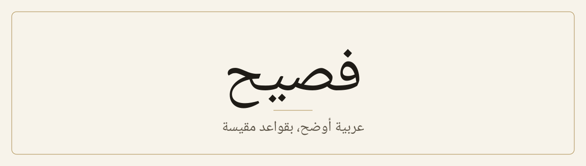

<div align="center">

<picture>
  <source media="(prefers-color-scheme: dark)" srcset="assets/banner-dark.svg">
  
</picture>

[العربية](./README.md) · [Full example](./examples/demo/README.md) · [Measurements](./references/research.md)

</div>

An Agent Skill that finds AI-sounding patterns in Modern Standard Arabic, proposes edits, and changes nothing until you agree.

| Before | After |
|---|---|
| ارتفعت الأسعار، حيث بلغت الزيادة 12%. | ارتفعت الأسعار، وبلغت الزيادة 12%. |
| هذا التطبيق ليس مجرد أداة للتواصل، بل منصة لإدارة العمل. | يجمع هذا التطبيق التواصل وإدارة العمل. |

## Install

```bash
git clone https://github.com/viasaud/fasih.git ~/.claude/skills/fasih
```

Then, in a new session, type `/fasih` with a file name or your text.

## Evidence

Each rule was measured on 4,669 news pairs: a human article against a text on the same material from one of three models. Ratios are the model's rate divided by the human rate.

| Pattern | GPT-3.5 | Gemini | Command R | Verdict |
|---|---|---|---|---|
| «مما» | 3.75× | 7.52× | 1.69× | Edit proposed |
| «، حيث» | 3.10× | 1.58× | 3.56× | Edit proposed |
| «تمّ» | 1.61× | 0.54× | 0.48× | One model's habit |
| «من خلال» | 1.05× | 0.73× | 0.43× | Left alone |
| «من أجل» | 0.65× | 0.13× | 0.39× | Left alone |

## Limits

- **Not a detector:** 13% of human articles exceeded the highest density we measured.
- **Narrow evidence:** news rewritten by older models, with no free writing and no Claude.
- **Religious text:** Quran, hadith, poetry and quotations are masked, but review them yourself.

---

<sub>Adapted from [lieflat-less-ai-tone](https://github.com/larashero3-dotcom/lieflat-less-ai-tone) by shiujan, who has not endorsed this adaptation. Data from [ALHD](https://doi.org/10.5281/zenodo.17249602). Licensed [CC BY-NC 4.0](./LICENSE). Details in [NOTICE.md](./NOTICE.md).</sub>
