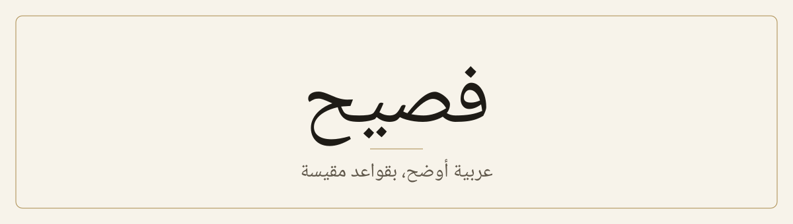

<div align="center">

<picture>
  <source media="(prefers-color-scheme: dark)" srcset="assets/banner-dark.svg">
  
</picture>

[English](./README.en.md) · [مثال كامل](./examples/demo/README.md) · [القياس](./references/research.md)

</div>

<div dir="rtl">

مهارة لمساعدك الذكي تجد الأنماط الآلية في النص العربي الفصيح، وتقترح تعديلها، ولا تغيّر حرفًا قبل موافقتك.

| قبل | بعد |
|---|---|
| ارتفعت الأسعار، حيث بلغت الزيادة 12%. | ارتفعت الأسعار، وبلغت الزيادة 12%. |
| هذا التطبيق ليس مجرد أداة للتواصل، بل منصة لإدارة العمل. | يجمع هذا التطبيق التواصل وإدارة العمل. |

## التثبيت

<div dir="ltr">

```bash
git clone https://github.com/viasaud/fasih.git ~/.claude/skills/fasih
```

</div>

ثم اكتب في جلسة جديدة: `/fasih` مع اسم الملف أو النص.

## الدليل

قسنا كل قاعدة على 4669 زوجًا من الأخبار: مقال بشري يقابله نص عن المادة نفسها من أحد ثلاثة نماذج. النسبة هي كثافة النمط عند النموذج مقسومة على كثافته عند البشر.

| النمط | GPT-3.5 | Gemini | Command R | الحكم |
|---|---|---|---|---|
| «مما» | ×3.75 | ×7.52 | ×1.69 | يُقترح تعديله |
| «، حيث» | ×3.10 | ×1.58 | ×3.56 | يُقترح تعديله |
| «تمّ» | ×1.61 | ×0.54 | ×0.48 | عادة نموذج واحد |
| «من خلال» | ×1.05 | ×0.73 | ×0.43 | لا يُمس |
| «من أجل» | ×0.65 | ×0.13 | ×0.39 | لا يُمس |

## حدوده

- **ليس كاشفًا،** فقد تجاوزت 13% من المقالات البشرية أعلى كثافة قسناها.
- **القياس محدود** بأخبار أعادت صياغتها نماذج أقدم، دون كتابة حرة ودون Claude.
- **يحجب الآيات والأحاديث** والشعر والاقتباسات، لكن راجعها بنفسك.

---

<sub>مشتق من [lieflat-less-ai-tone](https://github.com/larashero3-dotcom/lieflat-less-ai-tone) لصاحبه shiujan، ولا يتبناه المؤلف الأصلي. البيانات من [ALHD](https://doi.org/10.5281/zenodo.17249602). الترخيص [CC BY-NC 4.0](./LICENSE). التفاصيل في [NOTICE.md](./NOTICE.md).</sub>

</div>
